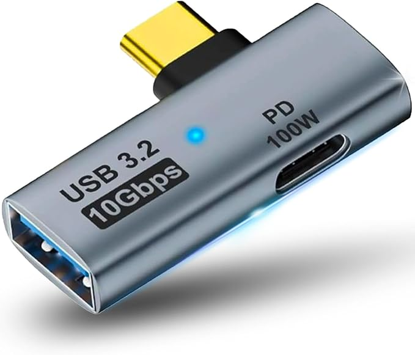
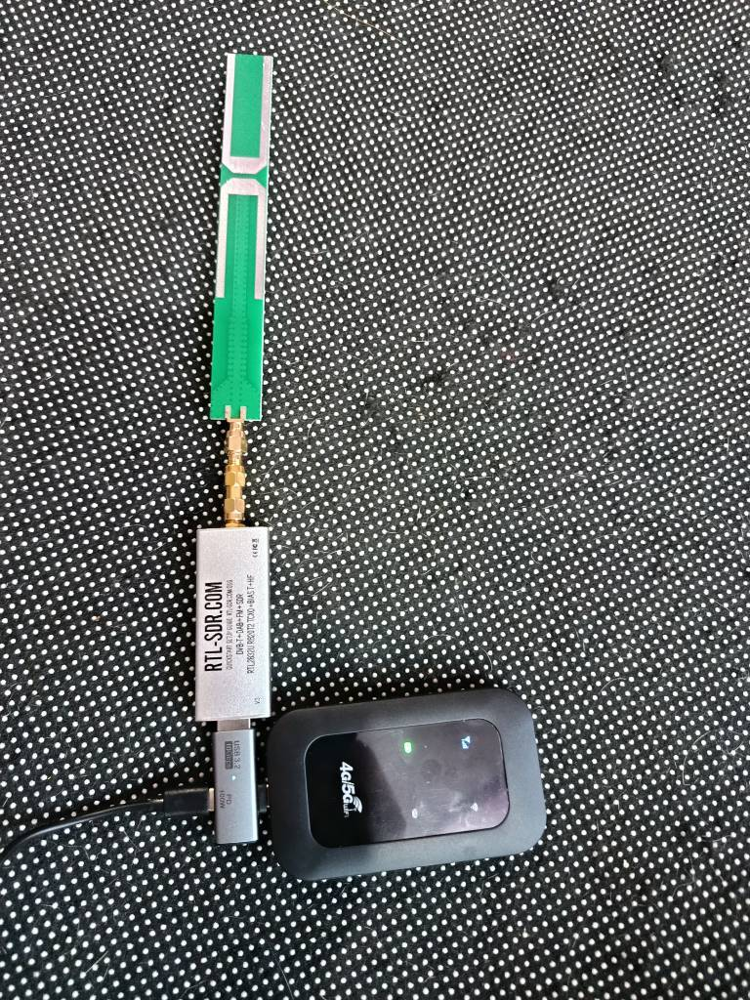
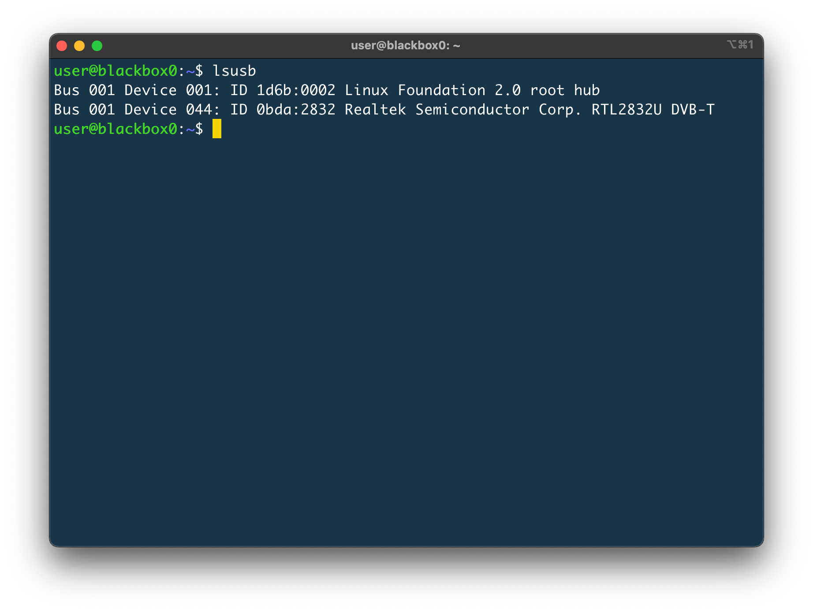
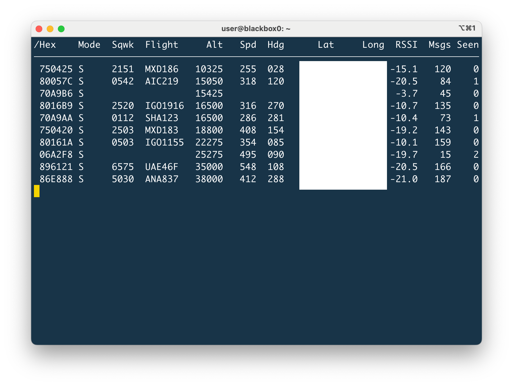
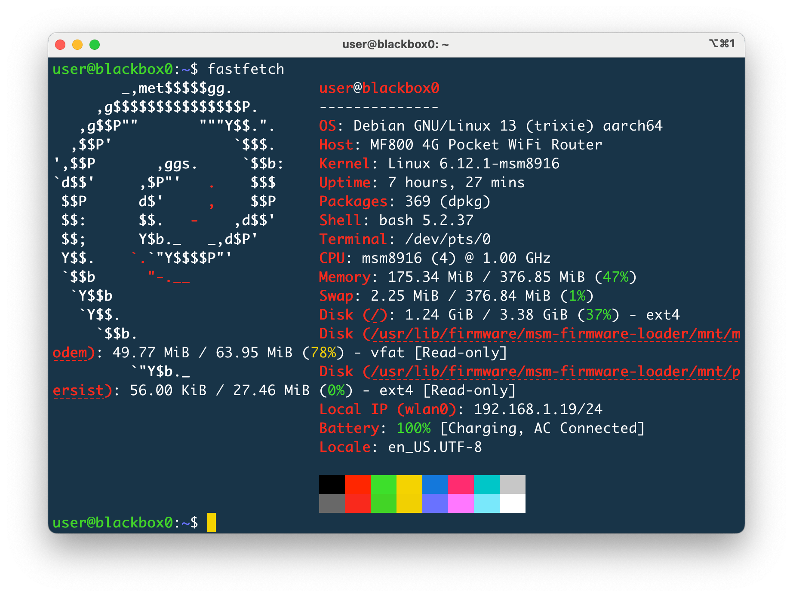
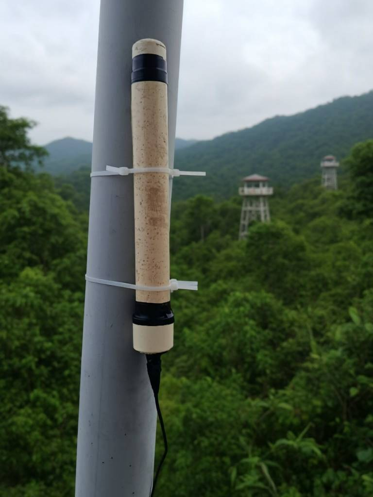
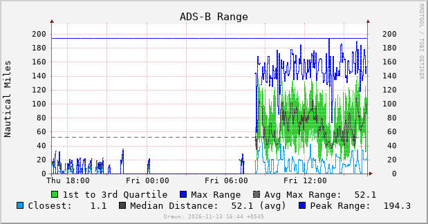
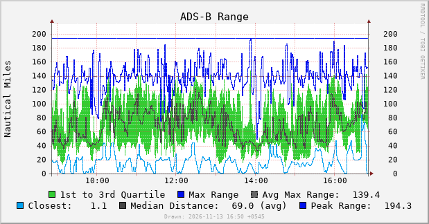

# OpenStick (MSM8916) Flash & ADS-B Receiver Setup Guide

A reference guide for flashing Debian Linux onto a Qualcomm MSM8916 4G LTE USB dongles (mine is `MF800-2` / `FY_MF800_V3.0` and used as reference here, but this guide applies to any stick supported by OpenStick) and configuring it as a lightweight, low-power ADS-B flight tracker. 

Already flashed OpenStick? Go directly to [Setting Up the ADS-B Receiver](#adsb-setup).

---
<a name="openstick-setup"></a>
## 1. Installing OpenStick

Depending on your hardware revision, choose the appropriate flashing method:
* **Standard "Stick" Dongles (`UZ801`, `UFI001C`, `UFI003`, `HMUF02` etc):** Use the automated 1-Click Installer available at [OpenStick.org](https://openstick.org). Simply launch the script for your OS and follow the on-screen prompts.
* **Other boards not supported by 1-click installer yet:** Use one of the community [OpenStick-Builder](https://github.com/kinsamanka/OpenStick-Builder) forks. While [LongQT-sea's fork](https://github.com/LongQT-sea/OpenStick-Builder/) is widely recommended, it caused bootloops on my `MF800-2` (4-LED variant, PCB marking `FY_MF800_V3.0` — see [Issue #27](https://github.com/LongQT-sea/OpenStick-Builder/issues/27)). The fork by [vernonet](https://github.com/vernonet/OpenStick-Builder) worked reliably on this board. I however, highly recommend to first check if your device is supported by 1-click installer as it is very convenient. 

### Flashing Unsupported Boards (EDL Backup + Fastboot Method)

> **Warning:** The standard `OpenStick-Builder` README instructs you to flash `aboot` via EDL (`edl w aboot aboot.mbn`), erase `boot`, and run `edl reset` to enter Fastboot. On the `FY_MF800_V3.0`, this causes an immediate bootloop. If your device already supports `adb reboot bootloader` (or hardware-button Fastboot), skip the EDL `aboot` step and flash directly via Fastboot.

#### Step 1: Backup Stock Firmware & Modem Partitions (EDL Mode)
Boot the dongle into Qualcomm EDL (9008) mode (`adb reboot edl` or via test points) and create a full flash backup along with individual backups of your IMEI/calibration partitions:

```bash
# 1. Create a full raw backup (can be restored via: edl wf orig_fw.bin)
edl rf orig_fw.bin

# 2. Backup critical modem, EFS, and persist partitions
for n in fsc fsg modem modemst1 modemst2 persist sec; do
    edl r ${n} ${n}.bin
done
```

#### Step 2: Flash OpenStick Images via Fastboot
Reboot the device into Fastboot mode (`adb reboot bootloader` or `edl reset` after restoring stock) and flash the built images directly (see [kinsamanka/OpenStick-Builder#21](https://github.com/kinsamanka/OpenStick-Builder/issues/21#issuecomment-6661616165)):

```bash
fastboot flash partition gpt_both0.bin
fastboot flash aboot aboot.mbn
fastboot flash hyp hyp.mbn
fastboot flash rpm rpm.mbn
fastboot flash sbl1 sbl1.mbn
fastboot flash tz tz.mbn
fastboot flash boot boot.bin
fastboot flash rootfs rootfs.bin
```

#### Step 3: Restore Original Modem Partitions & Reboot
Restore your backed-up calibration and IMEI partitions so Wi-Fi and cellular hardware function properly:

```bash
for n in fsc fsg modem modemst1 modemst2 persist sec; do
    fastboot flash ${n} ${n}.bin
done

fastboot reboot
```

> **Note on USB Networking:** If `usb0` does not appear via RNDIS on your host computer after booting, connect via the default Wi-Fi hotspot (`4G-UFI-XX` or `Openstick`, password `1234567890` or `openstick`) and SSH into `user@192.168.100.1` (or `192.168.4.1`) with password `1`.

### Post-Install Hardening
Before installing ADS-B software, connect the OpenStick to your Wi-Fi network, set up the Wi-Fi hotspot fallback, enable Zram swap, and move `journald` logs to volatile RAM to prevent eMMC flash wear. Follow my post-install guide here:
* [OpenStick Post-Install Configs](https://github.com/bkb3/OpenStick-post-install-configs)

---
<a name="adsb-setup"></a>
## 2. Setting Up the ADS-B Receiver

### Hardware Prerequisites
* **Compute:** Qualcomm MSM8916 LTE USB Dongle running OpenStick Debian
* **Radio:** RTL-SDR USB Dongle (e.g., RTL-SDR Blog V3/V4 or Nooelec NESDR)
* **Antenna:** 1090 MHz ADS-B Antenna (PCB patch antenna used here)
* **Power & Connectivity:** USB OTG Y-splitter cable (data + external 5V power injection) and a reliable 5V phone charger

I used this usb-c splitter. 
<p align="center">

</p>

### Hardware Connection Topology
Because the OpenStick USB port cannot supply enough current to power an RTL-SDR on its own, use a powered OTG Y-cable to inject 5V power directly to both devices:

```text
[ 5V Wall Charger ] ──(Power)──┐
                               ├──> [ USB OTG Y-Splitter ] <──(Data/Power)──> [ RTL-SDR ] <──(Coax)── [ 1090 MHz Antenna ]
[ OpenStick Dongle ] ──(OTG)───┘
```
<p align="center">

</p>


---

### Step 1: Enable USB Host Mode

> **Important:** Ensure your Wi-Fi connection (and Wi-Fi hotspot fallback) is working **before** switching to Host Mode. Once enabled, the OpenStick's USB port acts as a host for the RTL-SDR rather than a USB network gadget, meaning **USB SSH (`usb0`) will no longer work**. You can also use my fallback method on my [OpenStick Post-Install Configs](https://github.com/bkb3/OpenStick-post-install-configs#2-automated-wi-fi-hotspot-fallback-headless-safety-net) which opens up the default hotspot if WiFi isn't connected after a reboot.  

By default, OpenStick boots into USB Gadget (device) mode. Switch it to Host Mode temporarily to verify that your RTL-SDR is detected (`lsusb`):

```bash
sudo sh -c "echo host > /sys/devices/platform/soc@0/78d9000.usb/ci_hdrc.0/role"
```

Check if `lsusb` shows your device.
<p align="center">

</p>

#### Make USB Host Mode Permanent on Boot
Create a `systemd` service so the USB port switches to Host Mode automatically before `readsb` starts:

```bash
sudo nano /etc/systemd/system/usb-host-mode.service
```

Paste the following configuration:

```ini
[Unit]
Description=Set USB OTG port to Host Mode
After=systemd-udev-settle.service
Before=readsb.service

[Service]
Type=oneshot
ExecStart=/bin/sh -c 'echo host > /sys/devices/platform/soc@0/78d9000.usb/ci_hdrc.0/role'
RemainAfterExit=yes

[Install]
WantedBy=multi-user.target
```

Save and exit (`Ctrl + O`, `Enter`, `Ctrl + X`), then reload `systemd` and enable the service:

```bash
sudo systemctl daemon-reload
sudo systemctl enable usb-host-mode.service
```

---

### Step 2: Install ADS-B Software

SSH into your OpenStick device over Wi-Fi and install the ADS-B decoder, web map, and system monitor:

#### 1. Install `readsb` (ADS-B Decoder)
The automated script by [wiedehopf/readsb](https://github.com/wiedehopf/readsb) compiles `readsb` with RTL-SDR support and configures the `systemd` service:

```bash
sudo bash -c "\$(wget -O - https://github.com/wiedehopf/adsb-scripts/raw/master/readsb-install.sh)"
```

Set your antenna's decimal latitude and longitude (this automatically updates `/etc/default/readsb` and centers the map):

```bash
sudo readsb-set-location XX.XXXX YY.YYYY
```

*(Optional)* Enable automatic gain optimization for your RTL-SDR:
```bash
sudo readsb-gain auto
```

#### 2. Install / Update `tar1090` (Web Map Interface)
Note that `readsb-install.sh` automatically installs [wiedehopf/tar1090](https://github.com/wiedehopf/tar1090) unless passed the `no-tar1090` flag. To install or update it manually:

```bash
sudo bash -c "\$(wget -nv -O - https://github.com/wiedehopf/tar1090/raw/master/install.sh)"
```
Once complete, view live aircraft traffic at `http://<OPENSTICK_IP>/tar1090` (or `http://openstick0.local`) or your terminal using `viewadsb`.
<p align="center">

</p>

#### 3. Install `graphs1090` (Performance & System Stats)
Install [wiedehopf/graphs1090](https://github.com/wiedehopf/graphs1090) to monitor CPU load, RAM usage, message rates, and reception range:

```bash
sudo bash -c "\$(curl -L -o - https://github.com/wiedehopf/graphs1090/raw/master/install.sh)"
```
View performance charts at `http://<OPENSTICK_IP>/graphs1090`.

> **Resource Footprint:** All three services (`readsb`, `tar1090`, and `graphs1090`) run comfortably on the MSM8916's 512 MB RAM and quad-core Cortex-A53 CPU without choking the system—especially when `zram` is enabled.

<p align="center">
  
</p>

---

## 3. Outdoor Enclosure & Deployment Notes

* **Weatherproofing:** House the PCB patch antenna inside a sealed PVC pipe with a silica gel packet inside to absorb condensation. Wrap cable entry points and end caps with electrical tape or silicone sealant.<br>
<p align="center">
  
</p>

* **Indoor Placement:** Run the coaxial cable indoors to the RTL-SDR and OpenStick setup powered by a dedicated 5V USB wall adapter.


---

## 4. Tips & Lessons Learned
* **Keep Coax Runs Short (< 5 meters):** ADS-B operates at **1090 MHz** (L-band microwave), where coaxial cable attenuation is severe. Using a 10m cable degraded signal strength so heavily that maximum range was capped at **~20 nautical miles**. Shortening the coax run to **5 meters** boosted average reception range to **~140 nautical miles**. See the fig below where the difference in range is drastic.

  | 10m vs 5m Coax Cable Range (24h) | 5m Coax Cable Range (8h) |
  | :---: | :---: |
  |  |  |

* **Avoid Long 5V USB Cables:** Do not compensate for a short coax cable by running a long 5V USB power cable to the roof/outdoors. Standard 5V USB lines suffer significant voltage drop over distance, especially under the combined current draw of an MSM8916 board and an RTL-SDR, leading to undervoltage reboots and crashes. Keep both the USB power cable and coax run short—or if you must mount the unit remotely, run a higher-voltage DC line (e.g., 12V or PoE) with a local 5V buck converter right next to the OpenStick.

## 5. Future
Since RTL-SDR is working fine, the setup can also be used for any project that uses SDR. I was able to easily compile [`rtl_power_fftw`](https://github.com/AD-Vega/rtl-power-fftw) so I plan to use another dongle for radio astronomy projects such as 21 cm Hydrogen spectrum. I am currently already doing [21 cm neutral Hydrogen line measurements](https://github.com/bkb3/hydrogen-observatory/) in a device running armbian, so I might use another OpenStick device to do something else, maybe pulser hunting!
